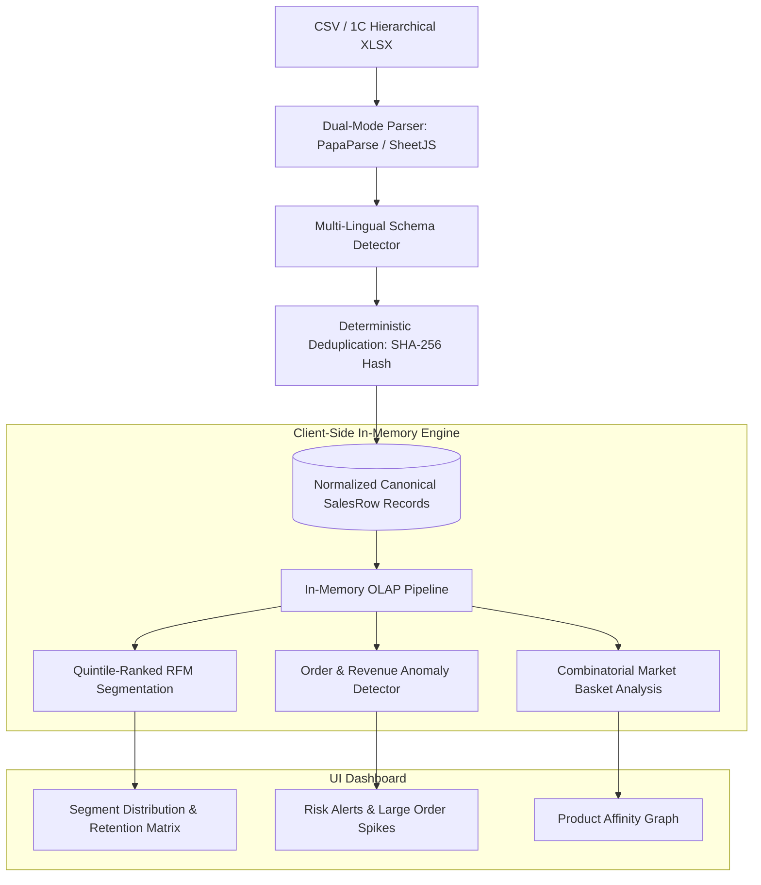

# Technical Case Study: In-Memory Sales Analytics & RFM Engine

**System:** Business Intelligence & Customer Segmentation Dashboard  
**Codebase:** `sales_analytics/dashboard`  
**Role:** Sole Architect & Developer  
**Timeline:** Mid-Late 2026  
**Stack:** Next.js 16 (React 19), TypeScript 5, Prisma 6, Recharts, PapaParse, SheetJS (`xlsx`), Tailwind CSS 4

---

## 1. Problem Statement
The business processed hundreds of B2B transactions through legacy 1C accounting exports and varied spreadsheet formats (XLSX, CSV). Key business challenges included:

* **Format Heterogeneity:** Invoices and export formats changed columns and languages (Ukrainian, Russian, English) dynamically depending on the branch or billing system.
* **Lack of Visibility on Customer Retention:** Management had no automated way to distinguish growing accounts from churning clients or assess customer lifetime frequency without manual data entry.
* **Data Duplication:** Uploading updated historical files frequently caused duplicate line entries, distorting margin calculations.

---

## 2. In-Memory Client-Side Analytical Architecture



---

## 3. Algorithmic Deep Dive

### 3.1 RFM Segmentation with Tied-Rank Quintile Scoring
To prevent arbitrary hardcoded cutoffs, `src/lib/analytics/rfm.ts` uses statistical quintiles calculated dynamically over the active dataset:

```typescript
function quintile(values: number[], value: number, reverse = false): number {
  const sorted = [...values].sort((a, b) => a - b);
  const firstIdx = sorted.indexOf(value);
  const lastIdx = sorted.lastIndexOf(value);
  const midIdx = (firstIdx + lastIdx) / 2; // Midpoint handling for equal values
  const pct = (midIdx + 0.5) / sorted.length;
  const score = Math.min(5, Math.max(1, Math.floor(pct * 5) + 1));
  return reverse ? 6 - score : score;
}
```

* **Recency:** Days since last order calculated relative to latest recorded dataset timestamp. Inverted quintile scoring ($1 \dots 5$).
* **Frequency & Monetary:** Distinct order counts and total transaction volume mapped to rank-based quintiles ($1 \dots 5$).
* **Segments:**
  * **VIP / Core:** $R \ge 4 \land F \ge 4 \land M \ge 4$
  * **At Risk:** $R \le 2 \land F \ge 3$
  * **Dormant VIPs:** $R \le 2 \land F \le 2 \land M \ge 3$
  * **Lost / Churn:** $R \le 2$

### 3.2 Dual-Condition Anomaly Detection
Rather than relying on basic thresholds, large outlier orders are identified using a combined percentile and dispersion filter (`src/lib/analytics/anomalies.ts`):

$$\text{Anomaly} \iff \text{TotalOrderAmount} > P_{95}(\text{Orders}) \land \text{TotalOrderAmount} > 3 \times \overline{\text{OrderAmount}}$$

Ensures regular seasonal variations don't trigger false alarms unless orders strictly exceed both the 95th percentile and triple the empirical dataset mean.

### 3.3 Combinatorial Market Basket Analysis (Co-Purchase)
Identifies cross-selling opportunities across multi-item invoices:
1. Groups products per order into canonical sets.
2. Orders items lexicographically ($A < B$) to prevent directional duplicates ($A+B$ vs. $B+A$).
3. Generates pairwise co-occurrences in $O(N \cdot K^2)$ time and surfaces top 30 complementary pairs.

---

## 4. Ingestion Resilience & Deduplication
To allow safe recurring re-uploads of historical reports:
* **Deterministic Line Hashes:** Computes a SHA-256 fingerprint for each row:
  $$\text{Hash} = \text{SHA256}(\text{DocID} \parallel \text{Date} \parallel \text{Customer} \parallel \text{Product} \parallel \text{Sequence} \parallel \text{Qty} \parallel \text{Amount})$$
* **Atomic Deduplication:** Executes inside `prisma.$transaction`. Re-uploading an entire month's ledger updates batch metadata while skipping existing matching transaction hashes.

---

## 5. Key Engineering Wins
* **Zero Roundtrip Interactivity:** Filtering by multiple managers, date ranges, and categories executes entirely in browser memory via pure functional reduction, eliminating server latency.
* **Format Flexibility:** Auto-detects 1C hierarchical outline levels, standard Excel sheets, and CSVs across 3 languages automatically.
